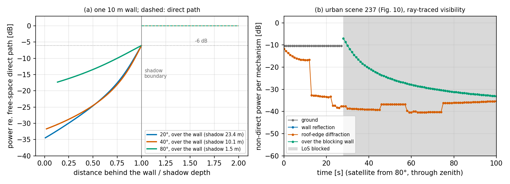

# Joint Delay–Doppler Modeling of Multipath LEO Channels — code and data

Companion code for *Joint Delay–Doppler Modeling of Multipath LEO Channels* (K.-P. Chiu and S. Roy, University of
Washington; submitted to IEEE Trans. Aerosp. Electron. Syst.).

The repository has two parts. `model/` is the per-path channel model of Sec. IV with a tapped-delay-line (TDL)
front end for link simulation, demonstrated in `examples/`. `paper_delivery/` holds everything behind the model curves
of Sec. VI: the numerical evaluators, their precomputed outputs, the reference rows plotted next to the model, and one
plot script per figure; `paper_delivery/reproduce_figures.sh` regenerates the figures from the shipped data in about
30 s.

The model in one paragraph: walls are a planar Poisson point process of finite segments with Rayleigh-distributed
heights around a terminal at 1.5 m; a satellite on a 550 km circular orbit passes overhead. At any instant the
non-direct channel is the set of specular wall reflections (image of the terminal in the wall plane), roof-edge
diffractions (exact stationary point on the roof edge, UTD wedge coefficient), the ground reflection and, when a wall
blocks the direct path, the diffraction over that wall's roof edge into its shadow (knife-edge loss), each with a
closed-form visibility probability (the finite-segment blockage rule). Statistics are evaluated in two states, LoS
(direct path clear, ground reflection present) and NLoS (direct path and ground reflection blocked together, the
blocking-wall diffraction present), with `P_LoS = E[1_0]` in closed form.

Requirements: Python ≥ 3.10 with `numpy`, `scipy`, `matplotlib` (`pip install -r requirements.txt`). Tested with
numpy 2.4, scipy 1.17, matplotlib 3.10.

## Layout

```
model/       physical_model.py   Sec. IV per-path model on one drawn city (geometry, visibility, ray tests)
             material.py         Fresnel and UTD kernels (ITU-R P.2040 concrete, P.526 wedge)
             tdl.py              TDLChannel: complex taps h_k[n] of eq. (tdl_cir) on a drawn city, for link simulation
examples/    tdl_link_sim.py     QPSK-OFDM link over the time-varying TDL (tap map, |H(f,t)|, BER vs time)
             blocking_wall_diffraction.py   the diffraction over the wall that blocks the direct path (mechanism 4)
paper_delivery/
  evaluate/  eval29.py           per-state PDP, RMS delay spread, RMS Doppler spread, coherence time vs elevation
             run_v2_all.py       LoS-state mechanism powers, valid-path counts, K-factor; joint delay-Doppler dump
             tsta_v2.py          stationarity time T_sta vs elevation (Sec. V-C definition)
             scene_pdp_state.py  scene Monte Carlo of the state-conditioned PDP (ray-traced validation markers)
             cir_realization.py  one-scene TDL realization over 100 s windows (Fig. 10)
  plots/     plot_*.py           one script per figure (or figure pair); write into paper_delivery/figures/
  data/model/       outputs of evaluate/ used by the paper (JSON, NPZ)
  data/scenemc/     scene-MC PDP histograms (JSON)
  data/references/  reference rows plotted next to the model (TR 38.811, 6G-NTN D4.1, scatterer bound)
  figures/          regenerated figures (PDF + PNG) and the numbers printed with them (CSV, JSON)
  reproduce_figures.sh
```

## Using the model in a link simulator

`model/tdl.py` turns the per-path model into the TDL of Sec. IV-F,

    h_k[n] = 1_0(t_n) δ_k0 + Σ_{i: ⌊τ_i(t_n)/T_s⌋ = k} √W_i(t_n) e^{jφ_i} e^{-j2π f_c τ_i(t_n)},

on one drawn city with ray-traced visibility: the direct path is tested against every wall, each wall / roof-edge path
from its interaction point to the terminal, and the ground reflection shares the direct-path indicator. `τ_i` is the
excess delay relative to the direct path, so the taps are already LoS-Doppler-compensated: tap 0 holds the unit
direct path when it is clear, every other path rotates at its residual Doppler `ν_i = −f_c dτ_i/dt` (below ~1 Hz), and
`φ_i` is one random initial phase per path, fixed for the life of that path. Powers are relative to the free-space
direct path; path loss and noise scaling are the caller's.

```python
import sys; sys.path.insert(0, 'model')
import numpy as np
from tdl import TDLChannel
ch = TDLChannel('urban', seed=237, T_s=1/30.72e6, n_taps=64)   # city seed 237 = the Fig. 10 scene; T_s = NR sample period
t0 = ch.time_at_elevation(20.)                                  # satellite at 20 deg, ascending (zenith is t = 0)
h, info = ch.taps(t0 + 0.5)                                     # complex taps at t0 + 0.5 s; info: los, n_wall, n_edge, n_block, ...
H = np.fft.fft(h, 1024)                                         # per-subcarrier response of a 1024-point OFDM system
taps, infos = ch.sequence(t0, 20.0, 0.1)                        # (201, 64) taps every 100 ms over 20 s
```

`examples/tdl_link_sim.py [ELEV] [DURATION] [DT] [EsN0_dB]` runs QPSK OFDM (1024 subcarriers, 30 kHz spacing, CP 72
samples) through a snapshot every `DT` seconds with zero-forcing equalisation on the true response and plots the tap
powers, `|H_m|²` and the BER against time (`examples/tdl_link_sim_e20.png`, `_e80.png`). From 20° the scene has two
wall reflections (−6.5 and −8 dB at 43 and 20 ns) plus the ground (−6.5 dB at 3–7 ns); their beat with the direct path
sweeps a notch across the 20 MHz channel with a period of about 15 s, and the BER moves between the AWGN value and
10⁻¹ accordingly. From 80° (`80 40`) there is no wall reflection; the direct path and the ground bounce are blocked
together at t = 28 s by a wall 5.2 m away, which is the LoS → NLoS switch of eq. (existence). The diffraction over that
wall then carries the link, −7 dB at 28 s falling to −20 dB at 40 s, next to roof-edge paths below −37 dB, and the BER
rises to 0.1–0.4.
Because the non-direct residual Doppler is below ~1 Hz, taps can be held over a slot and refreshed every 10–100 ms
(about 0.1 s per snapshot, dominated by the ray tests against ~25 000 walls). The direct path's own Doppler, which the
receiver pre-compensates, is not part of this model (Sec. III gives it in closed form).

## Diffraction over the blocking wall (mechanism 4, added October 2026)

The submitted version of the model had roof-edge diffraction (mechanism 2) only for walls with the satellite and the
terminal on the same side: the edge sends signal back toward a terminal in front of the wall once the wall's specular
point has risen above the roof. It had no path for the opposite case, the wall that blocks the direct path, so a
terminal in a wall's shadow kept only the reflections and back-scattering edges of other walls. A terminal in a wall's
shadow receives the signal that diffracts over that wall's roof edge: −6 dB at the shadow boundary, weaker deeper in
the shadow, at almost no excess delay. `Model.paths()` now returns this path (mechanism 4) for every wall that blocks
the direct path (the same test as `Model.clear`):

* diffraction point: the exact stationary point on the roof edge (the Newton solve of mechanism 2); a wall whose
  stationary point lies beyond its ends gives no path, as for mechanism 2;
* power relative to the direct path: single knife-edge loss (ITU-R P.526 §4.1; the walls are thin screens)
  `J(v) = 6.9 + 20 log10(√((v − 0.1)² + 1) + v − 0.1)` dB with `v = 2 √(Δ/λ)`, `Δ` the excess path length over the
  direct path, times the spreading factor `(R/(d1 + d2))²` (≈ 1);
* delay `Δ/c`; Doppler from its time derivative, as for every path;
* visibility of the edge-to-terminal leg: analytic probability, or ray-traced with `geometric_blockage=True`; the
  satellite-to-edge leg is assumed clear, as for every path.

The path exists only when the direct path is blocked, so it belongs to the NLoS state:

* `eval29.py`: NLoS-state weight = its expectation over cities / `P_NLoS` (the LoS state is unchanged; the
  unconditional statistics include it with its expectation);
* `run_v2_all.py` (LoS-state mechanism powers, K, the joint delay–Doppler dump) leaves it out; its output is unchanged
  (to 2·10⁻¹⁵ relative), so Figs. 7, 8 and 14 are unchanged;
* `scene_pdp_state.py`, `cir_realization.py` and `model/tdl.py` ray-trace: a scene whose direct path is blocked gets the
  path from its blocking walls (`info['n_block']` in the TDL);
* `tsta_v2.py` uses unconditional weights and includes it.

Checks:

* one 10 m wall: −6.1 dB at the shadow boundary (the knife-edge value at `v = 0`), falling off into the shadow (example
  below, panel a);
* mechanisms 1–3 are bit-identical to the submitted version (40 city/time draws per scene, each with analytic and
  ray-traced visibility);
* averaged over drawn cities, the path agrees within 0.1–1.6 dB with an independent integral over the first blocking
  wall (distance, height and crossing angle drawn from the wall statistics);
* against Sionna RT (S band, block buildings with diffracting roof edges): the strongest over-roof diffraction path
  of each NLoS terminal is within a median −0.8 dB (25–75 %: −3.3 to +0.8 dB) of the knife-edge value at its own
  excess delay (96 terminals, 10–80°).

Effect on the paper results (`eval29_*_n6000_*.json`, submitted → now; LoS-state values are unchanged):

| | 10° | 20° | 40° | 80° |
|---|---|---|---|---|
| urban, NLoS DS [ns] | 121.1 → 117.9 | 61.1 → 58.5 | 24.6 → 22.3 | 15.9 → 8.2 |
| rural, NLoS DS [ns] | 63.9 → 50.6 | 38.6 → 26.4 | 32.3 → 16.1 | 38.1 → 9.5 |
| urban, NLoS RMS Doppler spread [Hz] | 0.075 → 0.072 | 0.129 → 0.122 | 0.246 → 0.222 | 0.309 → 0.168 |
| rural, NLoS RMS Doppler spread [Hz] | 0.034 → 0.027 | 0.064 → 0.044 | 0.175 → 0.090 | 0.612 → 0.154 |
| urban, NLoS non-direct power [dB] | −8.8 → −8.2 | −10.7 → −9.7 | −13.2 → −11.5 | −15.7 → −9.9 |
| rural, NLoS non-direct power [dB] | −13.6 → −10.6 | −16.3 → −12.2 | −19.2 → −12.9 | −21.2 → −9.1 |
| blocking-wall power, urban / rural [dB] | −16.9 / −13.6 | −16.5 / −14.3 | −16.4 / −14.1 | −11.2 / −9.4 |

The DS over all terminals changes by at most 0.8 ns, and `T_sta` (Fig. 16) is up to 12 % shorter at 50–65° and
within 3 % elsewhere. The effect is largest in rural areas and at high elevation, where few walls reflect and the
blocking wall's diffraction carries most of the NLoS power.

`examples/blocking_wall_diffraction.py` (about 20 s) draws (a) one 10 m wall with the terminal moved through its
shadow at 20°, 40° and 80°, and (b) the Fig. 10 urban scene from 80° with the non-direct power per mechanism every
second: after the LoS blockage at t = 28 s the blocking wall's diffraction starts at −7 dB and falls to −33 dB by
100 s, while the other roof-edge paths stay below −35 dB.



## Paper figures (`paper_delivery/`)

`./paper_delivery/reproduce_figures.sh` regenerates the figures below from the shipped data. Figs. 7, 8, 9 and 14
(LoS-state and closed-form results) come out pixel-identical to the submitted figures. Figs. 10, 12, 13, 15 and 16 and
their data are regenerated with the blocking-wall diffraction (mechanism 4, above): the NLoS curves of Figs. 12, 13
and 15 and the scene-MC NLoS markers of Fig. 12, the LoS-blocked part of the 80° window of Fig. 10 and the
unconditional `T_sta` of Fig. 16 change; their LoS-state curves do not. The submitted figures and data are at tag
`v1-submitted`. Fig. 12 comes out without the dotted QuaDRiGa curves of the submitted version (that data is not part
of this release); Fig. 10 is the realization described further down. Fig. 11 and the
schematic Figs. 1–6 are not produced by this repository. Output file names are the names used by the manuscript's
`\includegraphics` calls.

| Paper figure | Output file | Plot script | Model data (script that made it) | Reference data |
|---|---|---|---|---|
| Fig. 7, joint delay–Doppler PSD, urban 20°/80° | `joint_dd_v8.pdf` | `plot_joint_dd.py` | `joint_v2_urban_e20.npz`, `joint_v2_urban_e80.npz` (`run_v2_all.py urban 3000 5`) | — |
| Fig. 8, mechanism power and valid-path contributions | `fig_power_path_0915.pdf` | `plot_power_path_k.py` | `v2all_urban_n3000_s5.json`, `v2all_rural_n3000_s6.json` (`run_v2_all.py`) | — |
| Fig. 9, LoS / NLoS state probability | `fig_plos_state_0915.pdf` | `plot_plos.py` | closed form, evaluated in the script | TR 38.811 Table 6.6.1-1 (inline) |
| Fig. 10, one-scene TDL realization, 100 s from 20° and 80° | `cir_v2.pdf` | `plot_cir.py` | `cir_seed237.json` (`cir_realization.py run 237`) | — |
| Fig. 12, two-state PDP at 20° and 80° | `fig11_pdp_state_0915.pdf` | `plot_pdp.py` | six `eval29_*.json` merged (36 000 cities per scene); `data/scenemc/*.json` markers | — |
| Fig. 13, RMS delay spread vs elevation | `fig12_ds_state_0914.pdf` | `plot_ds_doppler.py` | `eval29_urban_n6000_s3.json`, `eval29_rural_n6000_s4.json` | `fig13_data.csv`, TR 38.811 NLOS rows (inline) |
| Fig. 14, K-factor vs elevation | `fig13_k_0915.pdf` | `plot_power_path_k.py` | `v2all_*_n3000_*.json` | TR 38.811, 6G-NTN, QuaDRiGa rows (inline) |
| Fig. 15, RMS Doppler spread and coherence time | `fig14_doppler_state_0914.pdf` | `plot_ds_doppler.py` | `eval29_*_n6000_*.json` | `wcl_bound_paper_plot_data.csv` |
| Fig. 16, stationarity time vs elevation | `fig_tsta_0915.pdf` | `plot_tsta.py` | `tsta_v2_n1000.json` (`tsta_v2.py 1000`) | — |

### Regenerating the data

All commands run from the repository root and write into `paper_delivery/data/`. Times are for one core of a
laptop-class CPU.

```
python3 paper_delivery/evaluate/eval29.py urban 6000 3            # Figs. 13, 15, part of 12; 15 elevations, ~35 min
python3 paper_delivery/evaluate/eval29.py rural 6000 4            #                                          ~55 min
python3 paper_delivery/evaluate/eval29.py urban 30000 11 10 40 80 # extra PDP cities for Fig. 12; ~1.5 h each
python3 paper_delivery/evaluate/eval29.py rural 30000 12 10 40 80
python3 paper_delivery/evaluate/eval29.py urban 30000 21 20       # 20-deg PDP; ~30 min each
python3 paper_delivery/evaluate/eval29.py rural 30000 22 20
python3 paper_delivery/evaluate/run_v2_all.py urban 3000 5        # Figs. 7, 8, 14; ~11 min (also writes the joint_v2 NPZ dumps)
python3 paper_delivery/evaluate/run_v2_all.py rural 3000 6        # ~15 min
python3 paper_delivery/evaluate/tsta_v2.py 1000                   # Fig. 16; ~1–2 h on 2 cores, cached per elevation
python3 paper_delivery/evaluate/scene_pdp_state.py urban 20 6000 21    # Fig. 12 markers; ~0.07 s per urban scene, 0.1 s per rural
python3 paper_delivery/evaluate/scene_pdp_state.py rural 20 10000 22   # (other marker files: urban 10/40/80 with 6000/10000/20000
                                                                       #  scenes, seeds 11/41/81; rural 10/40/80 with 10000/20000/42000, seeds 12/42/8283)
python3 paper_delivery/evaluate/cir_realization.py run 237        # Fig. 10; ~5 s
```

Every run is deterministic for a given seed (`numpy.random.default_rng(seed)`; the same cities are redrawn at every
elevation); re-running `run_v2_all.py` for both scenes reproduced the shipped JSON files exactly. Between seeds the
wall-power terms fluctuate by roughly 10 % above 40° because valid wall reflections are rare per city (the expected
number of valid wall paths is 0.7 at 10° and 0.07 at 70°): 20-city runs are useless, 3000–6000 cities give the curves
in the paper, 30 000 cities reduce the PDP tail noise by about 2.4× but do not remove it.

### Conventions shared by all evaluators

* Overhead pass on a 550 km circular orbit (`physical_model.set_pass_offset(0)` is the default), 2 GHz carrier,
  omnidirectional terminal at 1.5 m.
* Scenes: urban γ = 8 m, λ_b = 0.025π/40 m⁻² (1963 walls/km²), l_f = 20 m, line-crossing intensity λ_1D = 0.025 /m;
  rural γ = 3 m, λ_b = 0.02π/20 m⁻² (3142 walls/km²), l_f = 10 m, λ_1D = 0.02 /m, chosen so that `P_LoS` follows the
  TR 38.811 suburban/rural LOS row within 4 points. Cities are drawn inside a 2 km radius.
* Path powers are relative to the free-space direct path (direct path = 1). LoS-state non-direct power
  `P_nd^L = W_g + P_wall + P_edge`, NLoS-state `P_nd^N = P_wall + P_edge + P_block` (`P_block`: diffraction over the
  wall that blocks the direct path, NLoS only); PDPs are normalized to the non-direct power of
  their state; the LoS-state delay spread includes the direct path, Doppler spread and coherence time use the non-direct
  paths only; `K = 1/P_nd^L`.
* Doppler of every path by central difference of its delay (dt = 50 ms).
* `T_sta` (Sec. V-C): fraction of non-direct power that migrates out of a soft delay/Doppler cell (T_s = 33 ns,
  σ_ν = 0.1 Hz) at the local drift rates, threshold ε = 0.05, unconditional weights (ground carries `E[1_0] W_g`).
* The evaluators use the analytic visibility probability for walls and roof edges and `P_LoS` for the ground path;
  `scene_pdp_state.py`, `cir_realization.py` and `model/tdl.py` ray-trace instead
  (`Model.paths(..., geometric_blockage=True)`), which is what makes them independent checks of the analytic rule.

### The Fig. 10 realization

`cir_realization.py run 237` draws one urban city (seed 237, 24 664 walls) and rebuilds every path from scratch every
4 s over two 100 s windows with ray-traced visibility; path continuity comes from the frozen geometry, not from a
tracker. Seed 237 was chosen with `cir_realization.py search 0 260` under the rule "LoS clear during the whole 20°
window, at least one wall reflection at its start, and a LoS blockage on the descending side of the 80° window by a
wall at least 3 m from the terminal". Over the 260 seeds the number of valid wall reflections at the start of the 20°
window was 0 in 64 %, 1 in 32 % and 2 in 4.5 % of scenes; seed 237 is one of the 2-wall scenes, so it shows more wall
activity than a typical draw. What it shows: from 20°, two wall reflections at 43 ns (−6.5 dB) and 20 ns (−8 dB) plus
the ground tap at 3–7 ns; the 43 ns reflection ends at t ≈ 44 s when its specular point rises above the roof and the
same building's roof-edge diffraction takes over at 40 ns (−13 dB at 44 s, decaying to −29 dB by 96 s). From 80°
(through zenith at 12.8 s, descending to 38° at 100 s) there is no wall reflection at all; the direct path and the
ground tap are blocked together at t = 28 s (78.1° descending) by a wall 5.2 m from the terminal, after which the
diffraction over that wall carries the link: −7.0 dB at 28 s (0.0 ns excess delay), −20.5 dB at 40 s, −27.9 dB at 60 s
and −33.1 dB at 100 s (13 ns), while the other roof-edge paths stay at −35 to −40 dB (120–190 ns). The submitted
figure, without mechanism 4, showed only those roof-edge paths after the blockage. `data/model/cir_seed_search.log` lists the score of every seed.

### Reference data (`paper_delivery/data/references/`)

* `fig13_data.csv` — the DS rows of Fig. 13: TR 38.811 Tables 6.7.2-1a/3a LOS means (S band), 6G-NTN D4.1 urban
  (3.5 GHz, digitized from Figs. 44–45 of the report), the QuaDRiGa v2.8.1 `QuaDRiGa_NTN_*_LOS` configured means at
  2 GHz, and the model row of an earlier manuscript version (not plotted).
* `wcl_bound_paper_plot_data.csv` — the RMS Doppler spread rows of Fig. 15: QuaDRiGa LOS urban/rural and the
  scatterer-only upper bound of [14] ("WCL, hemisphere"). Both are carried over from the earlier manuscript version's
  pipeline; the "Model" rows in that file are from that version and are not plotted.
* TR 38.811 LOS-probability rows in `plot_plos.py`, NLOS delay-spread rows in `plot_ds_doppler.py`, and the K rows
  (TR 38.811, 6G-NTN, QuaDRiGa configured means) in `plot_power_path_k.py` are typed in from the specification tables
  (LOS probability verified against the ns-3 `channel-condition-model.cc` implementation).

QuaDRiGa raw outputs and the scripts that produced them are not distributed; the QuaDRiGa numbers above are the
plotted reference values only, recorded so that the figures can be rebuilt.

### Known limitations of the evaluators

* The analytic visibility rule treats the blockage of different paths as independent. The scene MC, which shares the
  blockers, gives NLoS-state wall power 3–16 % (urban) and 2–36 % (rural) below the analytic value and NLoS-state
  roof-edge power 9–44 % (urban) and 25–50 % (rural) below it (10–80°, from the shipped 30 000-city runs and MC files);
  the LoS-state wall and edge powers agree within 6 % and 14 %.
* The PPP has no exclusion zone around the terminal, so a wall can stand within a few metres of it; this is what
  produces LoS blockage at high elevation in single-scene realizations (Fig. 10: a 5.2 m-distant wall at 78°).
* Model PDP tails beyond ~300 ns at low elevation are sampling-noisy (few wall paths per 33 ns bin); 36 000 cities
  per scene are merged in Fig. 12.
* `tsta_v2.py` pools paths over 1000 cities per elevation; its urban curve carries roughly 5–10 % Monte Carlo noise.
* Blocking-wall diffraction (mechanism 4): every wall that blocks the direct path contributes its own single
  knife-edge path, and the powers add (no multiple-edge method such as Deygout); the vertical wall ends do not
  diffract, so a wall whose stationary point lies beyond its ends gives no path; the satellite-to-edge leg is assumed
  clear, as for every other path.
